# Windows Server 2025 Active Directory Home Lab

A small home lab built in VirtualBox to practise core IT Support and Windows administration tasks: setting up a domain controller, organising users and groups in Active Directory, handling typical helpdesk requests and applying a Group Policy.

## Environment

| Item | Details |
|---|---|
| Hypervisor | Oracle VirtualBox 7.x |
| Server OS | Windows Server 2025 Standard Evaluation (Desktop Experience) |
| Server name | DC01 (`DC01.lab.local`) |
| Domain | `lab.local` |
| Network | Adapter 1: NAT (internet access, 10.0.2.15). Adapter 2: Internal Network `labnet`, static IP `192.168.10.10`, mask `255.255.255.0` |
| Roles | Active Directory Domain Services (AD DS), DNS, File and Storage Services |

## What I did

1. Created the VM and installed Windows Server 2025 from the Microsoft Evaluation Center ISO.
2. Configured a static IP address on the internal network adapter.
3. Installed AD DS and DNS, promoted the server to a domain controller and created the forest `lab.local`.
4. Built a simple directory structure: Organizational Units `IT`, `Finance` and `HR`, test users in the `Finance` OU and a security group `Finance_users`.
5. Performed common helpdesk tasks in Active Directory Users and Computers (ADUC):
   - added users to a security group
   - reset a user password and forced a change at next logon
   - disabled and re-enabled a user account
   - reviewed the Account tab (logon name, account options, expiry)
6. Created a Group Policy Object and linked it to the `Finance` OU: User Configuration > Administrative Templates > Control Panel > *Prohibit access to Control Panel and PC settings* = **Enabled**.

## Screenshots

| # | What it shows |
|---|---|
| 1 | `ipconfig`: NAT adapter and internal adapter with static IP 192.168.10.10 |
| 2 | Server Manager: AD DS, DNS and File and Storage Services roles running |
| 3 | System Properties: `DC01.lab.local`, domain `lab.local` |
| 4 | ADUC: OUs (Finance, HR, IT) and Finance OU contents |
| 5 | Members of the `Finance_users` group |
| 6 | Reset Password dialog (force change at next logon) |
| 7 | Confirmation: password changed |
| 8 | Confirmation: account disabled |
| 9 | Confirmation: account enabled |
| 10 | User Account tab: logon name, account options, expiry |
| 11 | Group Policy Management: GPO linked to the Finance OU |
| 12 | GPO setting *Prohibit access to Control Panel and PC settings* enabled |

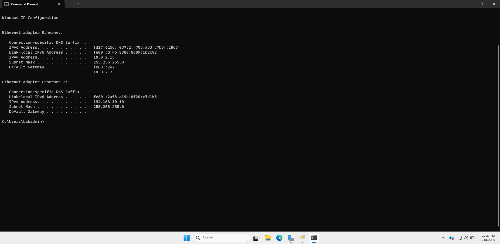
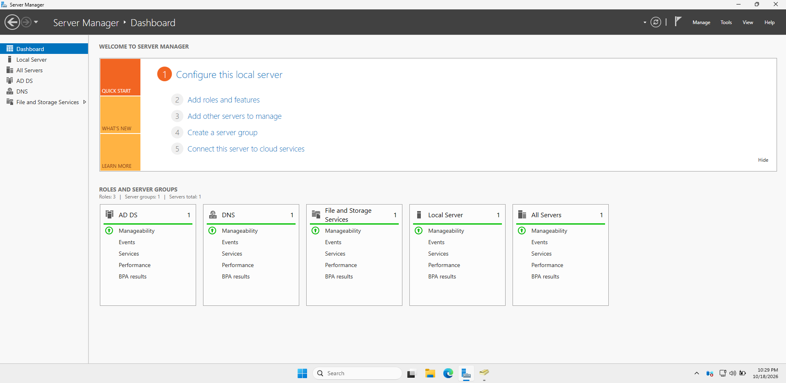
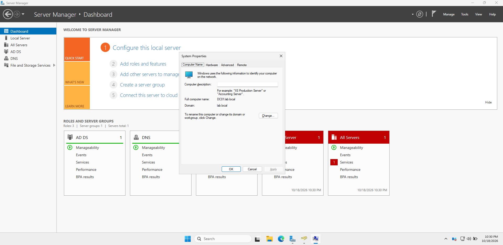
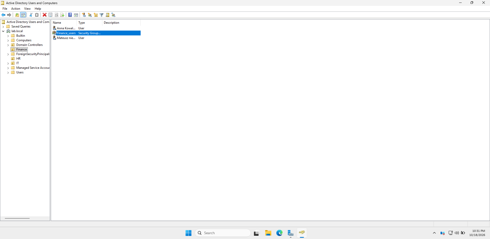
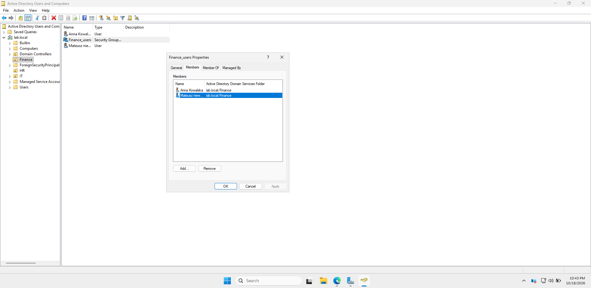
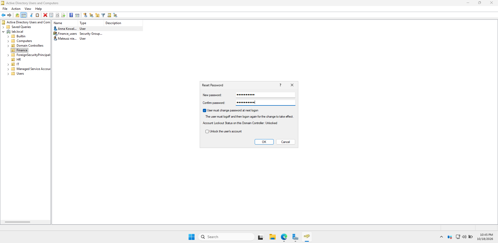
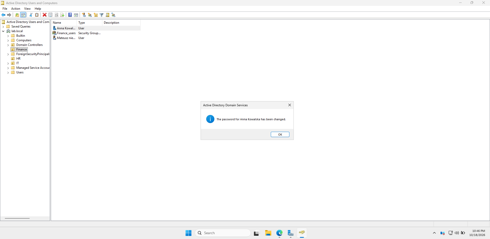
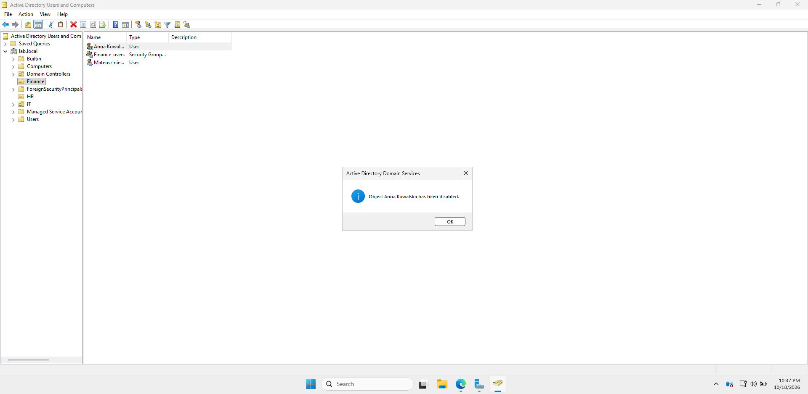
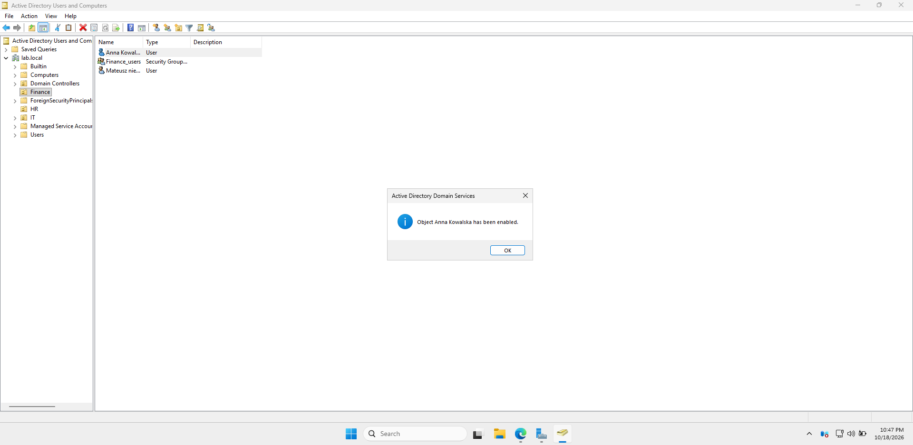
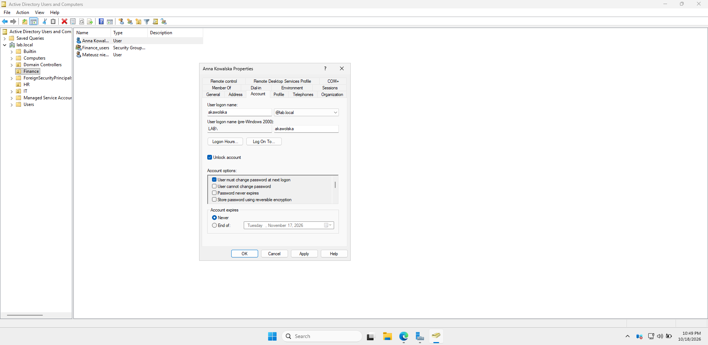
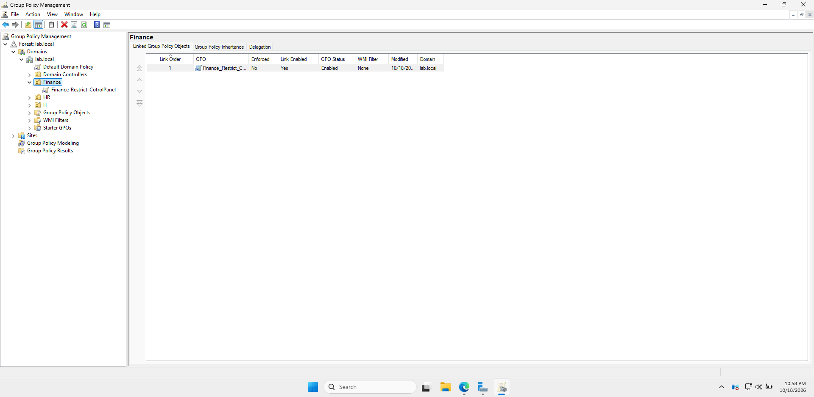
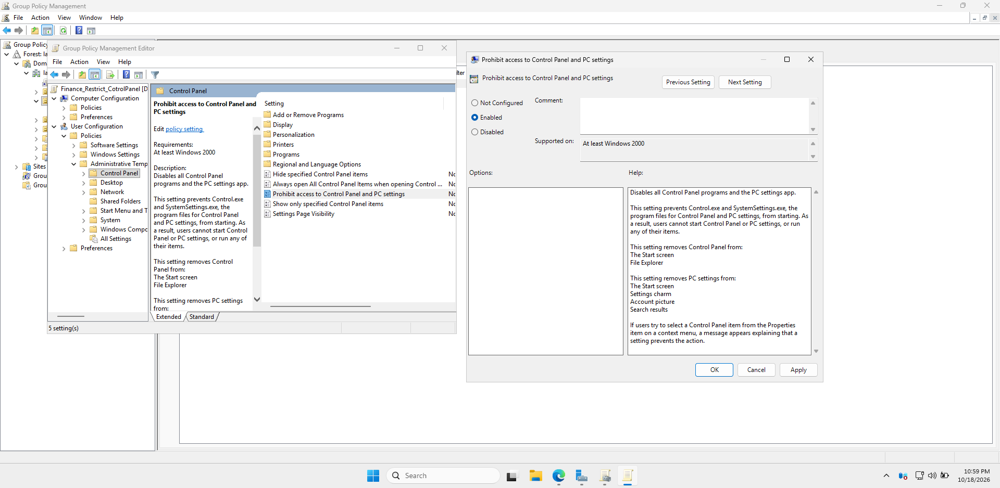

## What I learned

- Active Directory depends on DNS, and a domain controller needs a stable static IP.
- OUs and security groups make it possible to manage permissions and policies per team.
- The standard helpdesk flow for account problems: password reset, disable/enable, checking account options.
- How a GPO is created, linked to an OU and configured.
